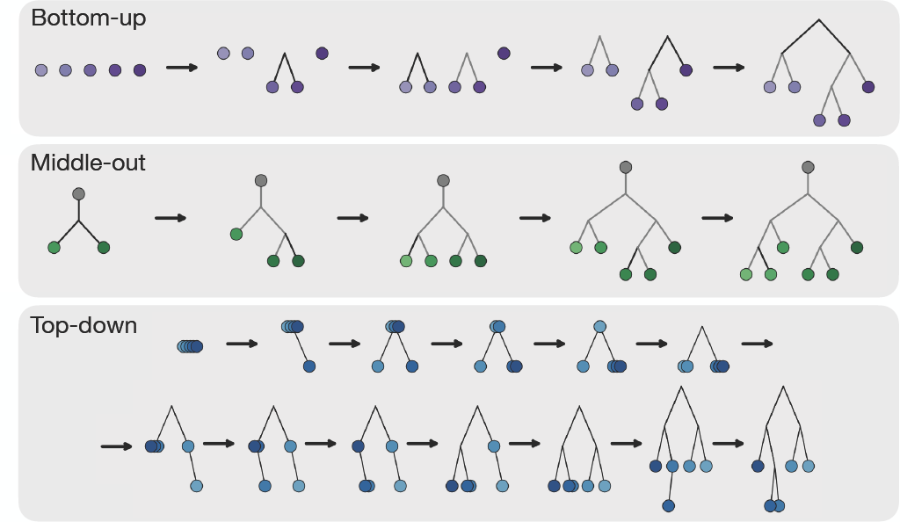

# Deep Generative Models for Phylogenetic Inference with Complex Evolutionary Processes

[Ethan Baron](https://baronet2.github.io/)\*, [Alan N. Amin](https://alannawzadamin.github.io)\*, [Andrew Gordon Wilson](https://cims.nyu.edu/~andrewgw/). * equal contribution

Paper: TBD!




## Abstract

Phylogenetic inference plays a central role in understanding evolutionary relationships, with applications ranging from tracking pathogen spread to reconstructing the history of life.
Conventionally, practitioners obtain posteriors over the phylogenetic tree of species using MCMC methods. 
However, such likelihood-based methods are only tractable for simple evolutionary models with restrictive assumptions. 
For more complex and realistic evolutionary models, conventional methods are prohibitively expensive, inaccurate, or even impossible.
We instead advocate for a simulation-based inference approach, by using simulated data from an evolutionary model to train a neural network that predicts tree topologies conditioned on sequences.
To accurately represent the complex posterior distributions over tree topologies that can arise, we present flexible models that iteratively generate trees using three natural paradigms: top-down, middle-out, and bottom-up.
We use a discrete diffusion framework to train these models efficiently on large-scale simulated datasets of phylogenetic trees.
For all three generative paradigms, our models fit the data substantially better than the previous state-of-the-art simulation-based method, Phyloformer 2, and obtain more accurate posteriors on real datasets. Finally, our models outperform misspecified conventional methods on data following complex evolutionary processes.

## Models

| `model=` | Name |
|----------|------|
| `middle_out` | Middle out |
| `bottom_up`  | Bottom up  |
| `top_down`   | Top down   |
| `phyloformer2` (baseline) | Phyloformer 2 |
| `quartformer` (baseline)  | QuartFormer   |

## Datasets

Pick the alignment simulator with `data/dataset_cfg=<jc|cat|indels>`:

- `jc` — DNA under Jukes–Cantor.
- `cat` — amino acids under the CAT mixture model.
- `indels` — DNA under GTR with indels + realignment.

## Setup

Requires Python 3.10, conda, and an NVIDIA GPU. `torch`, `dgl`, and `flash-attn`
come from CUDA-specific wheels; the sequence simulators (`iqtree`, `kalign3`) come
from bioconda. Everything else is declared in `pyproject.toml`.

```bash
conda create -n deepphylo python=3.10 -y
conda activate deepphylo

# GPU wheels — adjust the CUDA tag (cu130/cu128/cu126) to your driver
pip install dgl==2.4.0+cu121 -f https://data.dgl.ai/wheels/torch-2.2/cu121/repo.html
pip install torch==2.10.0 --index-url https://download.pytorch.org/whl/cu130
pip install https://github.com/mjun0812/flash-attention-prebuild-wheels/releases/download/v0.7.16/flash_attn-2.8.3+cu130torch2.10-cp310-cp310-linux_x86_64.whl

# Sequence simulators + this package (pulls the remaining deps)
conda install -c bioconda iqtree=3.0.1 kalign3=3.4.0 -y
pip install -e .
```

Or run `bash setup.sh` to do all of the above in one shot on a fresh machine.
Afterwards, just `conda activate deepphylo` before running.

Set `WANDB_API_KEY` to log to Weights & Biases, or pass `use_wandb=false` to
disable. Runs go to the `DeepPhylo` project under your default entity; pass
`wandb_entity=<team>` to log somewhere else.

## Training

Example commands:
```bash
python train.py model=middle_out   data/dataset_cfg=jc
python train.py model=bottom_up    data/dataset_cfg=cat
python train.py model=top_down     data/dataset_cfg=indels
python train.py +experiment=phyloformer2 data/dataset_cfg=jc   # baseline
python train.py model=quartformer data/dataset_cfg=jc train.gradient_clip_val=1.0
```

QuartFormer needs the tighter gradient clip; the default of 500 is set for the
diffusion models.

Multi-GPU is automatic (DDP). `effective_batch_size` is held fixed regardless of
GPU count — `train.py` derives gradient accumulation from it. Checkpoints and the
resolved run config are written to `checkpoints/<run>/`, where `<run>` is the W&B
run name (a timestamp by default; set `RUN_NAME=<name>` to choose it).
In our paper we ran our models for 48 hours on two A100s.

To resume from a checkpoint, pass `restart=<run>`.

## Sampling

Sampling loads the model + data config from the training checkpoint, so you only
name the run and an output file:

```bash
python sample.py run=<checkpoint-dir> sampling.path=out.pkl
```

Samples are written to `samples/<sampling.path>` as a pickled list of
`(n_leaves, msa_length, i, true_newick, sampled_newick, seconds)` tuples. The
sampling grid is set by `sampling.n_leaves`, `sampling.msa_lengths`, and
`sampling.trees_per_n`; temperature by `sampling.temperature`.

For QuartFormer, `sampling.temperature` picks the decoding: above 0 each draw
samples every quartet's resolution from the model and runs one puzzling pass, so
draws approximate the posterior; 0 gives the point estimate (argmax quartets,
majority consensus over `eval_n_orderings` passes).

## Pretrained checkpoints

The models behind the paper's figures are on the Hugging Face Hub at
[`eb4727/DeepPhylo`](https://huggingface.co/eb4727/DeepPhylo), one directory per
`{method}_{dataset}` — method in `BU` / `MO` / `TD` / `PF2` / `QF`, dataset in
`JC` / `CAT` / `Indels`. Each holds `model.ckpt` and the `config.yaml` of the run
that produced it, so no further setup is needed.

```bash
pip install huggingface_hub
huggingface-cli download eb4727/DeepPhylo --local-dir checkpoints
```

Add `--include 'BU_JC/*'` to fetch one model instead of all 15. Then decode as
the paper does — 8 draws at temperature 1, summarized by their majority-rule
consensus:

```bash
python sample.py run=BU_JC sampling.temperature=1 \
    sampling.consensus_n_samples=8 sampling.path=BU_JC_cons8.pkl
```

This works for every method. A consensus tree can be polytomous where the draws
disagree, so it may have fewer than N-3 internal edges.
